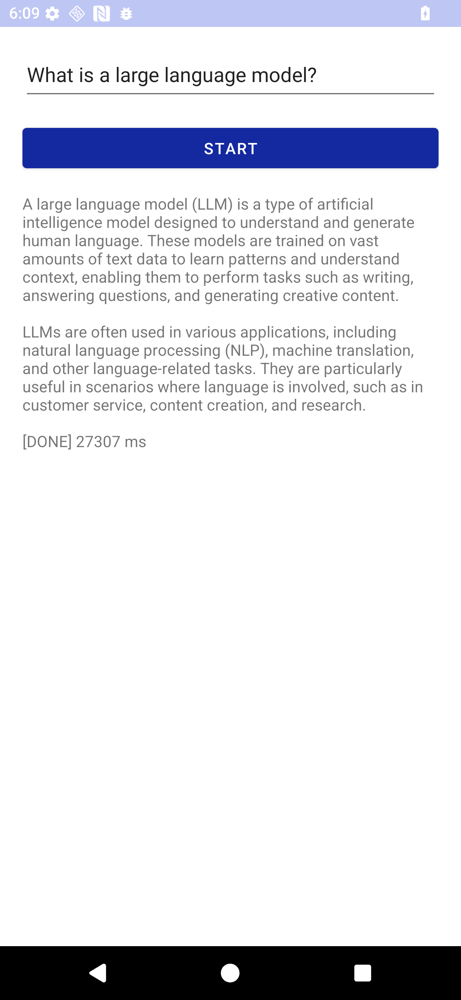

# Text Generation In Android
This document describes a method to operate Android sample application using the [Qwen3_0.6B](https://soc-developer.semiconductor.samsung.com/global/solution/ai/models/detail/Qwen3_0.6B?tab=float&chipset=Exynos+2600) model that is optimized for Exynos hardware.

## Functionality
This sample application performs text generation using a Large Language Model (LLM) based on text prompts entered by the user.  
The application consists of three neural network models: two prefill models and one decode model.  
The prefill models process the input prompt and initialize the Key-Value (KV) cache. The decode model generates output tokens autoregressively using the KV cache.  
Tokenization, input embedding, attention mask generation, RoPE calculation, KV-cache management, and LM head processing are handled by the application.  
The generated text is displayed incrementally on the screen, and the total inference time is displayed upon completion.  

  

## Getting Started
Perform the following steps to utilize the sample application:  
Due to the large file sizes, the model files and common package are not included in this GitHub repository. Please download the required files separately and follow the steps below to run the sample application.  
1. Download the FP16 version of the Qwen3-0.6B model from the model download link provided in the Text Generation In Android section above.  
2. Place the downloaded NNC model files in the text-generation/app/materials/models directory.  
3. Place the downloaded common_package in the text-generation/app/materials/common directory.  
4. Connect a device compatible with the target Exynos chipset of the downloaded NNC models. To transfer the NNC model files and common binary files to the device, run push-qwen3.bat located in the text-generation/app/script directory. For Linux environments, run push-qwen3.sh instead.  
5. Once all required files have been successfully transferred to the device, build and run the Android sample application using Android Studio.    
6. Enter a text prompt and press the START button to perform inference.  
7. Verify the generated text and the total inference time displayed on the screen.  

Perform the following steps to modify the model used in the sample application:  
1.	Copy the desired model file to the `assets` directory of the project.
2.	Copy the corresponding label text file to the `assets` directory.
3.	Modify the parameters in the ModelConstants.kt file to reflect the specifications of the new model.
4.	If the inputs and outputs of the model differ from the pre-designed sample application, modify the `preProcess()`, `postProcess()` and `convertBitmapToFloatArray()` functions.

## Compatible AI Models
Below is a list of models expected to be compatible with the sample application.  
**Note:** All models that are listed here are not individually tested with this application.  
[All_MiniLM_L6_V2](https://soc-developer.semiconductor.samsung.com/global/solution/ai/models/detail/All_MiniLM_L6_V2?tab=float&chipset=Exynos+2600)  
[DistilBert_Base_Uncased](https://soc-developer.semiconductor.samsung.com/global/solution/ai/models/detail/DistilBert_Base_Uncased?tab=float&chipset=Exynos+2600)  
[Google_Bert_Base_Chinese](https://soc-developer.semiconductor.samsung.com/global/solution/ai/models/detail/Google_Bert_Base_Chinese?tab=float&chipset=Exynos+2600)  
[Google_Bert_Base_Uncased](https://soc-developer.semiconductor.samsung.com/global/solution/ai/models/detail/Google_Bert_Base_Uncased?tab=float&chipset=Exynos+2600)  
[Mamba 1.4B](https://soc-developer.semiconductor.samsung.com/global/solution/ai/models/detail/Mamba%201.4B?tab=float&chipset=Exynos+2600)  
[MobileBERT](https://soc-developer.semiconductor.samsung.com/global/solution/ai/models/detail/MobileBERT?tab=float&chipset=Exynos+2500)  
[RoBerta_Base](https://soc-developer.semiconductor.samsung.com/global/solution/ai/models/detail/RoBerta_Base?tab=float&chipset=Exynos+2600)  